# TP05-Backend — API REST CRUD Produits (Node.js + Express.js)

> API REST CRUD de gestion de produits avec Node.js et Express.js : architecture en couches, validation avec express-validator, gestion centralisée des erreurs et documentation Swagger/OpenAPI (LAB 5 – Développement Backend).


---

## Sommaire

1. [Présentation](#1-présentation)
2. [Prérequis](#2-prérequis)
3. [Installation et démarrage](#3-installation-et-démarrage)
4. [Structure du projet](#4-structure-du-projet)
5. [Étapes du laboratoire](#5-étapes-du-laboratoire)
6. [Endpoints de l'API](#6-endpoints-de-lapi)
7. [Tests avec Postman](#7-tests-avec-postman)
8. [Tests avec cURL](#8-tests-avec-curl)
9. [Documentation Swagger](#9-documentation-swagger)
10. [Remarques](#10-remarques)

---

## 1. Présentation

Ce projet construit une **API REST CRUD** de gestion de produits avec **Node.js** et **Express.js**.
L'objectif est de produire une application exécutable, modulaire et documentée.

**Notions abordées :**

- Architecture en couches : Routes → Controllers → Services → Repositories (+ Models et Middlewares)
- Validation des entrées avec `express-validator`
- Gestion centralisée des erreurs
- Génération automatique de la documentation Swagger/OpenAPI

> **Note :** les données sont stockées **en mémoire**. Elles sont réinitialisées à chaque redémarrage du serveur.

---

## 2. Prérequis

- Node.js **18 ou plus** (LTS recommandée)
- npm
- Un éditeur de code (VS Code, WebStorm)
- Postman ou `curl.exe` pour tester les requêtes

---

## 3. Installation et démarrage

```bash
# 1. Cloner le dépôt
git clone https://github.com/Luchianhi/TP05-Backend.git
cd TP05-Backend

# 2. Installer les dépendances
npm install
```

Créer un fichier `.env` à la racine du projet. Ce fichier n'est pas versionné : il est exclu par `.gitignore`.

```env
PORT=3000
NODE_ENV=development
```

```bash
# 3. Démarrer le serveur (redémarrage automatique avec --watch)
npm run dev
```

| Script | Commande | Rôle |
|---|---|---|
| `npm start` | `node src/server.js` | Démarrer le serveur |
| `npm run dev` | `node --watch src/server.js` | Démarrer en mode développement |
| `npm run swagger` | `node swagger.js` | Régénérer la documentation OpenAPI |

---

## 4. Structure du projet

```
TP05-Backend/
├── images/                          # Captures d'écran du README
├── postman/
│   └── LAB5-Product-API.postman_collection.json
├── src/
│   ├── controllers/
│   │   └── product.controller.js    # Requêtes / réponses HTTP
│   ├── docs/
│   │   └── swagger-output.json      # Spécification OpenAPI générée
│   ├── middlewares/
│   │   ├── error.middleware.js      # Gestion centralisée des erreurs
│   │   └── validator.middleware.js  # Règles express-validator
│   ├── models/
│   │   └── product.model.js         # Classe Product + validation
│   ├── repositories/
│   │   └── product.repository.js    # Accès aux données (mémoire)
│   ├── routes/
│   │   └── product.routes.js        # Endpoints + annotations #swagger
│   ├── services/
│   │   └── product.service.js       # Logique métier
│   └── server.js                    # Point d'entrée de l'application
├── .gitignore
├── package.json
├── package-lock.json
└── swagger.js                       # Script de génération Swagger
```

| Couche | Rôle |
|---|---|
| **Routes** | Définissent les URL et les verbes HTTP |
| **Controllers** | Gèrent la requête HTTP et la réponse |
| **Services** | Contiennent la logique métier |
| **Repositories** | Gèrent l'accès aux données (en mémoire ici) |
| **Models** | Définissent la structure des objets |
| **Middlewares** | Validation, gestion des erreurs, journalisation… |

---

## 5. Étapes du laboratoire

### Étape 1 — Introduction et prérequis

Objectifs : construire une API REST CRUD avec Express, organiser le code en couches, valider les entrées, centraliser les erreurs et documenter l'API avec Swagger.

### Étape 2 — Initialisation du projet Node.js

```bash
mkdir node-product-api
cd node-product-api
npm init -y
```

Dans `package.json`, la ligne `"type": "module"` active les modules ES (`import` / `export`).
Un fichier `.gitignore` contenant `node_modules/` et `.env` évite de versionner ces éléments.

### Étape 3 — Installation des dépendances

```bash
npm install express dotenv express-validator swagger-ui-express swagger-autogen
```

```json
"scripts": {
  "start": "node src/server.js",
  "dev": "node --watch src/server.js",
  "swagger": "node swagger.js"
}
```

### Étape 4 — Architecture et structure des dossiers

```cmd
mkdir src\controllers src\middlewares src\models src\repositories src\routes src\services
type nul > src\server.js
type nul > swagger.js
```

<!-- 📷 Espace image : Image 01 — Structure du projet dans VS Code et serveur démarré -->
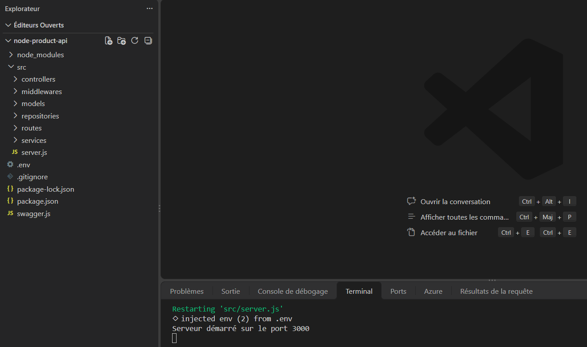

*Image 01 : arborescence du projet dans VS Code et message « Serveur démarré sur le port 3000 » après `npm run dev`.*

### Étape 5 — Création du modèle `Product`

`src/models/product.model.js` : la classe `Product` vérifie dans son constructeur que le nom n'est pas vide, que le prix est un nombre fini ≥ 0 et que le stock est un entier ≥ 0.

### Étape 6 — Implémentation du Repository

`src/repositories/product.repository.js` simule la base de données avec un tableau en mémoire : `findAll`, `findById`, `create`, `update` et `delete`.
L'instruction `{ ...productData, id }` garantit que l'identifiant de l'URL l'emporte sur un éventuel `id` présent dans les données reçues.

### Étape 7 — Couche Service

`src/services/product.service.js` : `getAllProducts`, `getProductById` (erreur **404** si le produit n'existe pas), `createProduct`, `updateProduct` et `deleteProduct`. La validation passe par le modèle, avec une erreur **400** si les données sont invalides.

### Étapes 8 à 11 — Controller (GET, POST, PUT/PATCH, DELETE)

`src/controllers/product.controller.js` : `getAll`, `getById`, `create` (**201**), `update` (PUT), `patch` (PATCH) et `remove` (**204**).
Chaque méthode transmet ses erreurs au middleware avec `next(error)`.

### Étape 12 — Middleware de validation

`src/middlewares/validator.middleware.js` : `validateId`, `validateProduct` (POST/PUT) et `validateProductPatch` (PATCH).
Si les données sont invalides, la réponse est **400** avec la liste des erreurs.

### Étape 13 — Configuration des routes Express

`src/routes/product.routes.js` relie chaque endpoint à ses middlewares de validation et à sa méthode du Controller. Le routeur est enregistré dans `server.js` sous le préfixe `/api/products`.

<!-- 📷 Espace image : Image 02 — GET /api/products -->
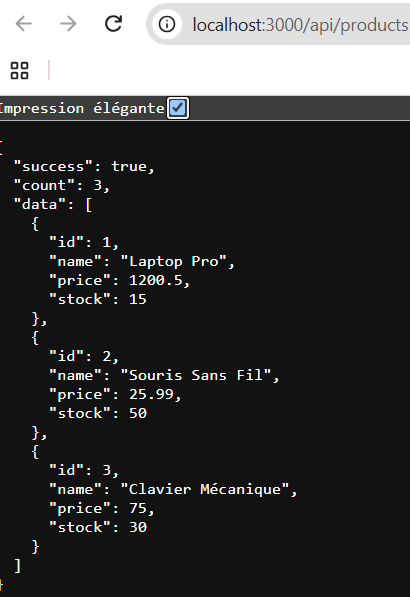

*Image 02 : `GET http://localhost:3000/api/products` renvoie la liste des 3 produits (`count: 3`).*

<!-- 📷 Espace image : Image 03 — GET /api/products/1 -->
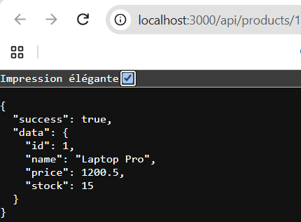

*Image 03 : `GET http://localhost:3000/api/products/1` renvoie le produit « Laptop Pro ».*

<!-- 📷 Espace image : Image 04 — GET /api/products/abc -->
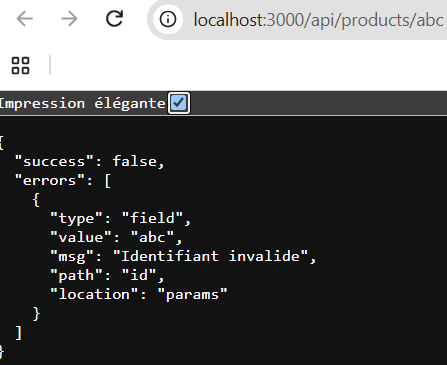

*Image 04 : `GET http://localhost:3000/api/products/abc` est rejeté par `validateId` (« Identifiant invalide »).*

### Étape 14 — Gestion centralisée des erreurs

`src/middlewares/error.middleware.js` intercepte les erreurs transmises avec `next(error)` et renvoie une réponse JSON uniforme. Il est déclaré **après toutes les routes**.

<!-- 📷 Espace image : Image 05 — GET /api/products/999 -->
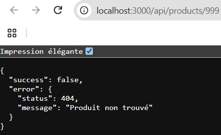

*Image 05 : `GET http://localhost:3000/api/products/999` renvoie `404` « Produit non trouvé » en JSON.*

### Étape 15 — Configuration du serveur Express

`src/server.js` charge `.env`, exécute `swagger.js`, lit `src/docs/swagger-output.json`, enregistre `express.json()`, les routes produits, `/api-docs.json`, `/api-docs` (Swagger UI), un middleware **404** (« Route non trouvée ») et enfin `errorHandler`.

### Étape 16 — Génération automatique de Swagger

`swagger.js` (à la racine) utilise `swagger-autogen` (OpenAPI 3.0) pour générer `src/docs/swagger-output.json`, avec les schémas `ProductInput`, `ProductPatch` et `Product`.

```bash
node swagger.js
```

### Étape 17 — Intégration de Swagger UI

- Swagger UI : <http://localhost:3000/api-docs>
- Documentation JSON : <http://localhost:3000/api-docs.json>

### Étape 18 — Annotations Swagger dans les routes

Les commentaires `#swagger.tags`, `#swagger.summary`, `#swagger.parameters`, `#swagger.requestBody` et `#swagger.responses` documentent chaque opération sans changer son fonctionnement.

<!-- 📷 Espace image : Image 06 — Swagger UI -->
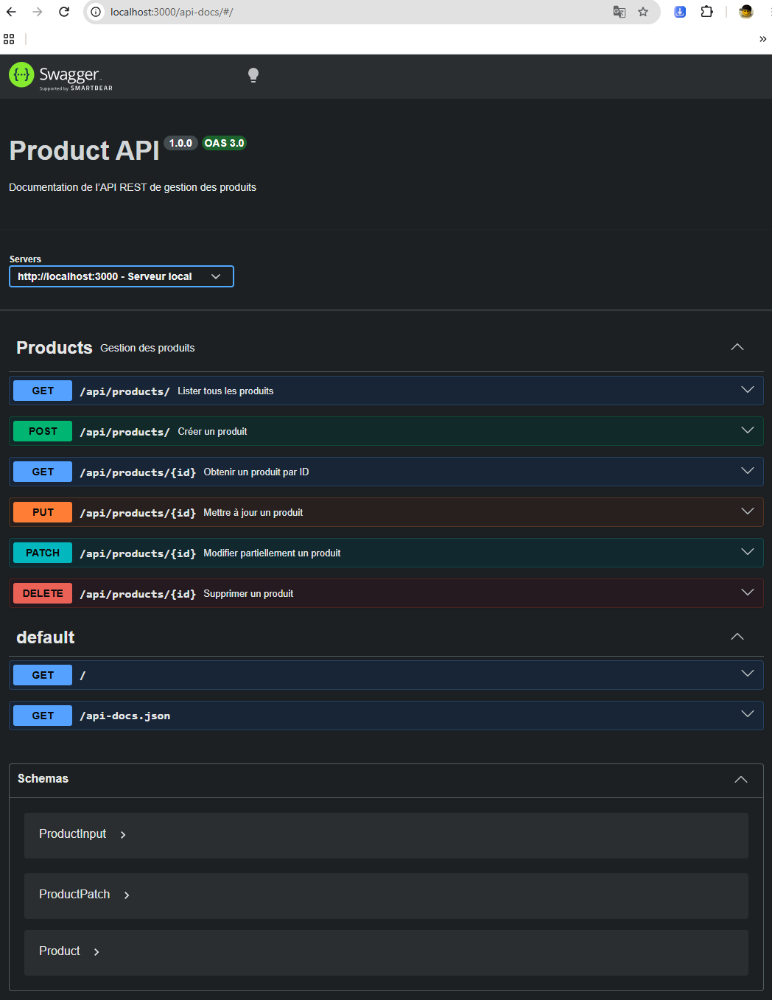

*Image 06 : Swagger UI, avec la catégorie **Products**, les 6 opérations CRUD et les schémas `ProductInput`, `ProductPatch` et `Product`.*

### Étape 19 — Tests des endpoints (cURL / Postman)

Voir les sections [7. Tests avec Postman](#7-tests-avec-postman) et [8. Tests avec cURL](#8-tests-avec-curl) (Images 07 à 12).

### Étape 20 — Tests des erreurs et de la validation

| Test | Requête | Attendu |
|---|---|---|
| ID invalide | `GET /api/products/1abc` | `400` + message de validation |
| Produit inexistant | `GET /api/products/999` | `404` (voir Image 05) |
| Corps invalide | `POST /api/products` `{"name":"","price":-1}` | `400` + erreurs listées (voir Image 12) |
| Route inconnue | `GET /api/unknown` | `404` « Route non trouvée » |

### Étape 21 — Vérification de la documentation Swagger

<!-- 📷 Espace image : Image 13 — /api-docs.json -->
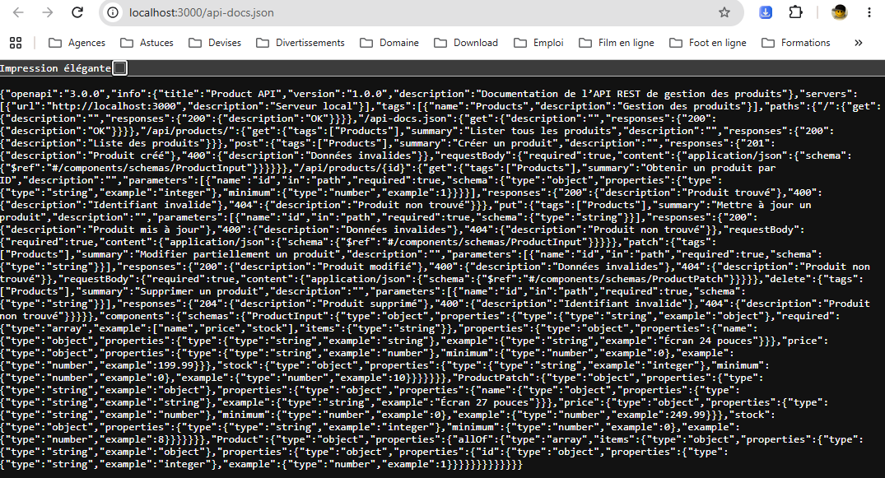

*Image 13 : `http://localhost:3000/api-docs.json` renvoie la spécification OpenAPI 3.0 brute.*

### Étape 22 — Résumé et conclusion

- **Architecture en couches :** séparation claire entre Routes, Controllers, Services et Repositories.
- **Validation robuste :** `express-validator` associé au modèle `Product`.
- **Gestion des erreurs :** middleware centralisé avec des codes HTTP appropriés.
- **Documentation automatique :** Swagger UI et OpenAPI générés dynamiquement.

**Pistes pour la suite :** base de données réelle (MongoDB, PostgreSQL), tests unitaires avec Jest, authentification JWT.

---

## 6. Endpoints de l'API

| Méthode | Endpoint | Validation | Succès | Erreurs |
|---|---|---|---|---|
| GET | `/api/products` | — | `200` | — |
| GET | `/api/products/:id` | `validateId` | `200` | `400`, `404` |
| POST | `/api/products` | `validateProduct` | `201` | `400` |
| PUT | `/api/products/:id` | `validateId`, `validateProduct` | `200` | `400`, `404` |
| PATCH | `/api/products/:id` | `validateId`, `validateProductPatch` | `200` | `400`, `404` |
| DELETE | `/api/products/:id` | `validateId` | `204` | `400`, `404` |
| GET | `/api-docs` | — | Swagger UI | — |
| GET | `/api-docs.json` | — | Spécification OpenAPI | — |

---

## 7. Tests avec Postman

### Importer la collection

1. Ouvrir Postman, puis **Import**.
2. Sélectionner le fichier [`postman/LAB5-Product-API.postman_collection.json`](postman/LAB5-Product-API.postman_collection.json).
3. La collection **LAB5 - Product API** apparaît avec les 6 requêtes, déjà configurées (méthode, URL, en-tête `Content-Type`, body JSON) et accompagnées de tests automatiques.

> La variable de collection `baseUrl` vaut `http://localhost:3000`. Redémarrer le serveur avant la série pour repartir des 3 produits de départ, puis lancer les requêtes dans l'ordre (ou utiliser **Run collection**).

### 1. GET Liste — `200 OK`

<!-- 📷 Espace image : Image 07 — Postman GET Liste -->
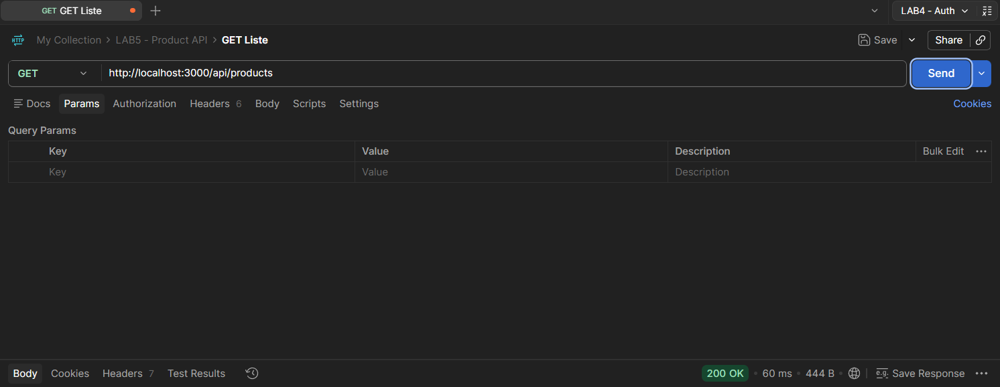

### 2. POST Création — `201 Created`

Body : `{"name":"Tapis","price":10,"stock":5}`

<!-- 📷 Espace image : Image 08 — Postman POST Création -->
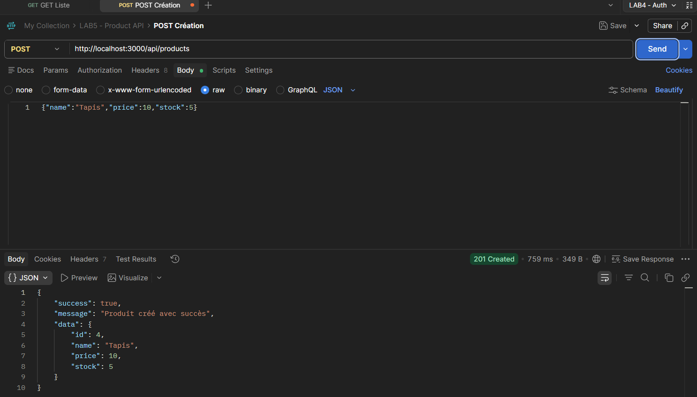

### 3. PUT Mise à jour — `200 OK`

Body : `{"name":"Clavier Gamer","price":80,"stock":10}`

<!-- 📷 Espace image : Image 09 — Postman PUT Mise à jour -->
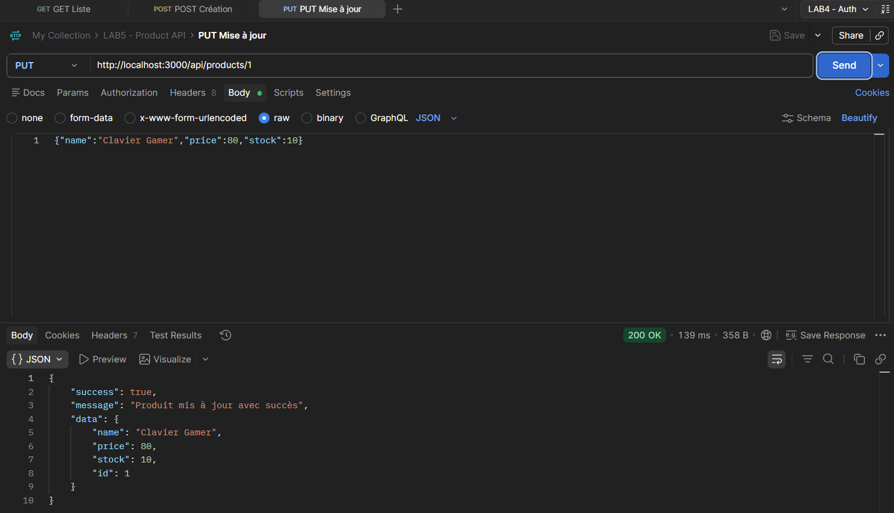

### 4. PATCH Mise à jour partielle — `200 OK`

Body : `{"stock":20}` (seul le stock change)

<!-- 📷 Espace image : Image 10 — Postman PATCH Mise à jour partielle -->
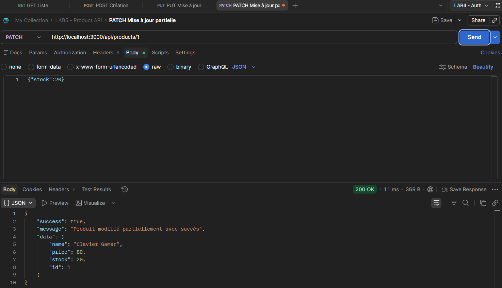

### 5. DELETE Suppression — `204 No Content`

<!-- 📷 Espace image : Image 11 — Postman DELETE Suppression -->
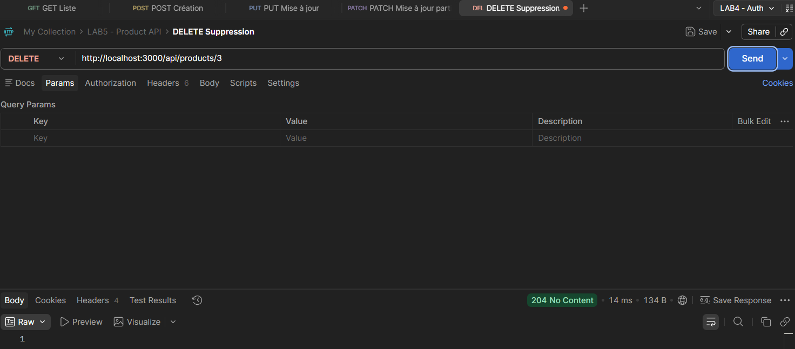

### 6. Corps invalide — `400 Bad Request`

Body : `{"name":"","price":-1}` (3 erreurs de validation)

<!-- 📷 Espace image : Image 12 — Postman Corps invalide -->
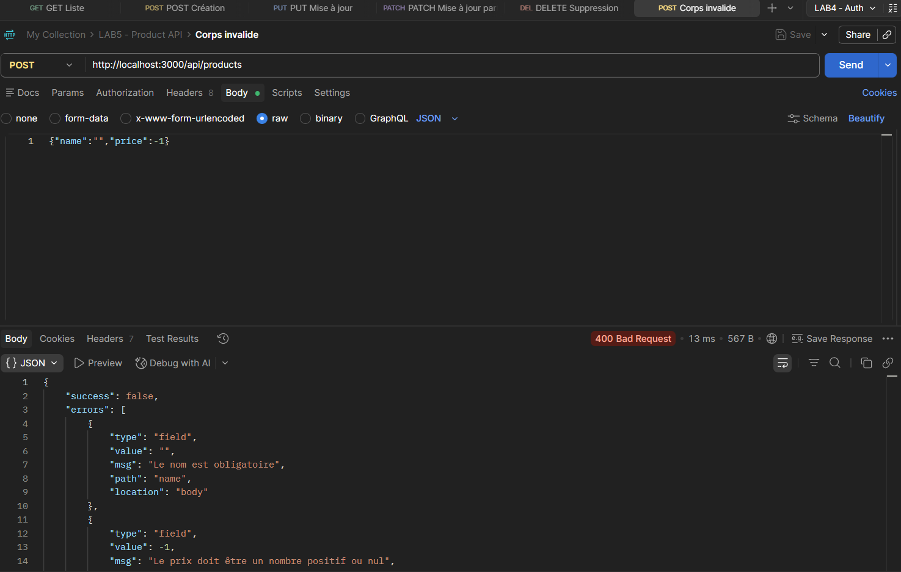

---

## 8. Tests avec cURL

Sous PowerShell, avec `curl.exe` :

```powershell
# 1. GET Liste
curl.exe http://localhost:3000/api/products

# 2. POST Création
curl.exe -X POST http://localhost:3000/api/products -H "Content-Type: application/json" -d '{"name":"Tapis","price":10,"stock":5}'

# 3. PUT Mise à jour
curl.exe -X PUT http://localhost:3000/api/products/1 -H "Content-Type: application/json" -d '{"name":"Clavier Gamer","price":80,"stock":10}'

# 4. PATCH Mise à jour partielle
curl.exe -X PATCH http://localhost:3000/api/products/1 -H "Content-Type: application/json" -d '{"stock":20}'

# 5. DELETE Suppression
curl.exe -X DELETE http://localhost:3000/api/products/3

# 6. Corps invalide
curl.exe -X POST http://localhost:3000/api/products -H "Content-Type: application/json" -d '{"name":"","price":-1}'
```

> **Windows PowerShell 5.1 :** PowerShell retire les guillemets du JSON passé à `curl.exe`. Il faut alors protéger chaque guillemet intérieur avec `\"`, par exemple :
> `-d '{\"name\":\"Tapis\",\"price\":10,\"stock\":5}'`

---

## 9. Documentation Swagger

| URL | Contenu |
|---|---|
| <http://localhost:3000/api-docs> | Interface interactive Swagger UI (bouton **Try it out**) |
| <http://localhost:3000/api-docs.json> | Spécification OpenAPI 3.0 au format JSON |

La documentation est régénérée à chaque démarrage du serveur. Elle peut aussi être régénérée manuellement avec `npm run swagger`.

---

## 10. Remarques

- **Correction du Service :** dans `validateProduct` (`src/services/product.service.js`), l'appel `new Product(null, name, price, stock)` a été remplacé par `new Product(name, price, stock)`, conformément au constructeur du modèle (`constructor(name, price, stock)`). Sans cette correction, toute création ou modification était rejetée avec une erreur 400.
- **Dossier `src/docs` :** il doit exister pour que `swagger-autogen` puisse écrire `swagger-output.json`.
- **Titre Swagger :** l'interface affiche « Product API », le titre défini dans `swagger.js`.

---

*LAB 5 — Module M10 Développement Backend — Master IAIDDWM.*
